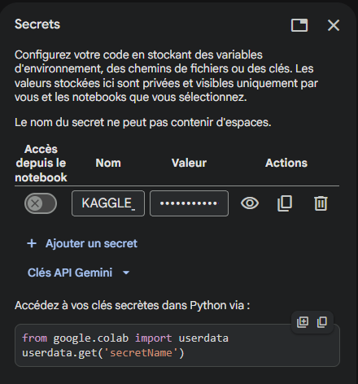

### SECRET à mettre avant de lancer le processus des 2 TPs :

Monsieur,
Si vous voulez que les 2 notebooks puisse se lancer sans erreur il vous faudra ma clé secrète à insérer ici :

[Si vous ne voyez pas l'image, mettez vous sur Google Colab, ouvrez mon .ipynb, appuyez sur la clé et "Ajouter un secret"]

Voici la clé : KGAT_17da4f8ea64338994a91f002a1974832